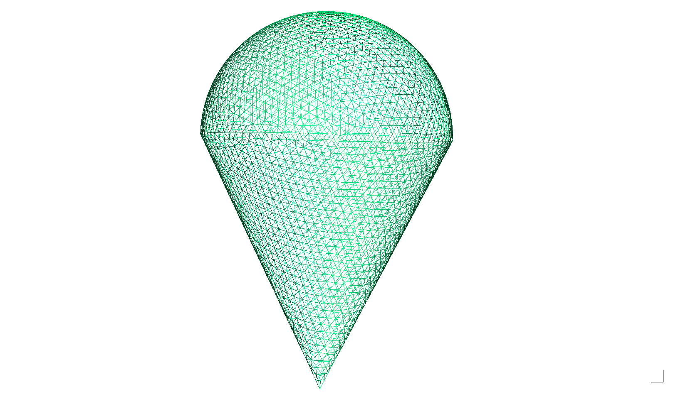
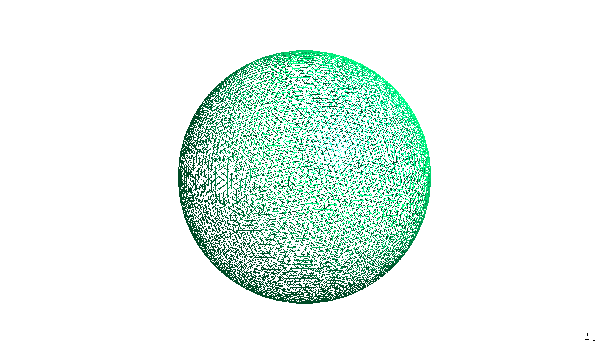
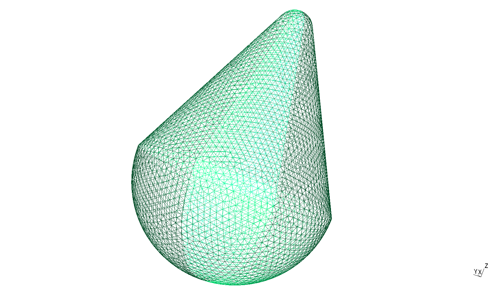

.. _mesh:

Mesh Requirements and Infrastructure
=====================================

The SIE/MoM solver operates on triangulated surface meshes. The shared Python
mesh generators use Gmsh :cite:`geuzaine2009gmsh` through its API to construct
the geometry and generate triangular surface meshes, which are exported as
``.obj`` files and loaded by ``ObjMeshLoader``.
This page documents what a mesh must satisfy to be usable by the solver,
how the ``ObjMeshLoader`` class enforces and verifies those requirements,
how the automated Catch2 tests validate the loader in isolation, and how
the standalone health-report tool is used to inspect real meshes generated
by external tools such as Gmsh.

Mesh Data Structure
-------------------

All mesh data is stored in the :cpp:struct:`MeshData` struct (defined in
``include/sie_mom/mesh/spherical_surface.hpp``):

.. list-table::
   :header-rows: 1
   :widths: 20 15 65

   * - Field
     - Shape
     - Description
   * - ``vertices``
     - :math:`N \times 3`
     - 3-D coordinates :math:`(x, y, z)` of each vertex.
   * - ``faces``
     - :math:`M \times 3`
     - Vertex-index triplets defining each triangle. Wound CCW when viewed
       from the outside.
   * - ``edges``
     - :math:`E \times 2`
     - Unique interior edges (canonical, sorted vertex pairs).
   * - ``faces_edges``
     - :math:`M \times 3`
     - For each face, the indices of its three edges in ``edges``.

The last two arrays are *derived* — they are computed automatically by
``ObjMeshLoader`` and are not present in the raw ``.obj`` file.

Mesh Examples
-------------

The following triangulated surface meshes illustrate the geometry and
element density expected by the solver.

  Cone-sphere mesh, viewed along its symmetry axis.

  Triangulated sphere mesh.

  Blunted nose-cone sphere mesh, oblique view.

Mesh Validity Requirements
--------------------------

A mesh is considered valid for the MoM assembly if and only if **all five**
of the following conditions hold.

.. list-table::
   :header-rows: 1
   :widths: 35 65

   * - Requirement
     - Why it matters
   * - **Euler characteristic** :math:`V - E + F = 2`
     - Necessary (not sufficient) condition for a closed, genus-0 surface.
       Any hole, extra detached face, or non-manifold connection breaks this.
   * - **Zero boundary edges**
     - An edge incident to only one face is a hole in the surface.
       The RWG expansion is undefined across a boundary edge.
   * - **Zero non-manifold edges**
     - An edge incident to three or more faces is a topological defect (e.g.
       a duplicate or T-junction). It makes the ``faces_edges`` mapping
       ambiguous and invalidates the RWG basis.
   * - **Single connected component**
     - A disjoint second component (e.g. a detached flap at the apex) adds
       :math:`+2` per extra component to :math:`\chi` and produces
       physically meaningless degrees of freedom in the solver.
   * - **RWG orientation invariant**
     - Each edge must be traversed in **opposite** directions by its two
       adjacent faces (one goes :math:`v_a \to v_b`, the other
       :math:`v_b \to v_a`). This is the prerequisite for the RWG basis
       function to have a well-defined, continuous normal component across
       the shared edge. See :cite:`rao1982electromagnetic`.

ObjMeshLoader Pipeline
-----------------------

``ObjMeshLoader`` accepts any triangulated ``.obj`` file and performs four
sequential cleanup and assembly steps before the mesh is handed to the solver.

.. code-block:: none

    parseFile()
        |  Read 'v' and 'f' records; handle 'v/vt/vn' index format.
        v
		mergeVerticesAndRemoveDegenerateFaces(tol = 1e-5)
        |  1. Fuse near-duplicate vertices (within tolerance).
        |  2. Discard degenerate faces (repeated vertex index).
        |  3. Discard duplicate faces (same canonical vertex set,
        |     regardless of winding) - guards against the Gmsh
        |     single-pass 360-degree revolve artifact.
        |  4. Remove orphan vertices no longer referenced by any face.
        v
		orientFacesCcwOutward()
        |  Compute mesh centroid; flip any face whose outward normal
        |  points inward toward the centroid.
        v
		buildEdgesAndMapping()
					 Enumerate unique edges and populate faces_edges.

Automated Tests (Catch2)
------------------------

The file ``tests/cpp/obj_mesh_loader_test.cpp`` contains five targeted test
cases.  Each exercises exactly one step of the cleanup pipeline using a
synthetic mesh with a known ground truth, so the tests are fully
self-contained and run without any external file dependency.

.. list-table::
   :header-rows: 1
   :widths: 40 35 25

   * - Test case
     - What it proves
     - Synthetic mesh used
   * - **Clean tetrahedron**
     - Basic assembly: correct V/E/F counts, :math:`\chi = 2`, every edge
       shared by exactly two faces, no duplicate edges or faces, RWG sign
       flip holds.
     - 4 vertices, 4 faces (tetrahedron).
   * - **Near-duplicate vertex** (offset :math:`10^{-6}`)
     - ``mergeVertices`` fuses the near-copy; result is topologically
       identical to the clean tetrahedron.
     - Tetrahedron with apex repeated at ``(0, 0, 1.000005)``.
   * - **Reversed duplicate face**
     - ``deduplication`` removes the reversed copy; :math:`\chi` still 2.
       Reproduces the Gmsh single-pass :math:`2\pi` revolve artifact.
     - Tetrahedron + extra face ``f 4 3 1`` (reversed copy of face 4).
   * - **Degenerate face** (``f 1 1 2``)
     - ``removeDegenerateFaces`` silently discards it; counts unchanged.
     - Tetrahedron + face with ``v_0 = v_1``.
   * - **Missing file**
     - ``ObjMeshLoader`` throws ``std::runtime_error`` on a bad path.
     - (no mesh — just a bad filename)

Run only the mesh loader tests with:

.. code-block:: bash

	 ./build/tests/cpp/run_cpp_tests "[mesh][obj_mesh_loader]"

Expected output::

	 Filters: [mesh][obj_mesh_loader]
	 ===============================================================================
	 All tests passed (45 assertions in 5 test cases)

Standalone Mesh Health Tool
----------------------------

``applications/mesh_plotting_apps/mesh_obj_loader_tool`` inspects a real
``.obj`` file produced by an external mesher (e.g. Gmsh) and prints a
structured health report.  Unlike the Catch2 tests, it operates on files
whose exact vertex/face counts change every time mesh parameters are adjusted,
so pass/fail is determined by the topological invariants above rather than
by fixed expected counts.

Usage:

.. code-block:: bash

	 ./build/applications/mesh_plotting_apps/mesh_obj_loader_tool <path_to_obj>

The tool checks all five validity requirements and prints a labelled
``[PASS]`` / ``[FAIL]`` line for each one, followed by an overall verdict.
Example output for a healthy mesh:

.. code-block:: none

	 === Mesh Health Report: blunted_cone_sphere.obj ===

		 Vertices : 4735
		 Faces    : 9466
		 Edges    : 14199
		 V-E+F    : 2

		 [PASS] Euler characteristic V-E+F = 2
		 [PASS] No boundary edges (no holes)  (0 found)
		 [PASS] No non-manifold edges (no 3+-incident edges)  (0 found)
		 [PASS] Single connected component  (1 found)
		 [PASS] RWG orientation: edges traversed in opposite directions by adjacent faces  (0 failures)

		 Overall: HEALTHY -- ready for MoM assembly.

**Exit codes**

.. list-table::
   :header-rows: 1
   :widths: 15 85

   * - Code
     - Meaning
   * - ``0``
     - All checks passed; mesh is ready for the MoM solver.
   * - ``1``
     - One or more topology checks failed.
   * - ``2``
     - File could not be opened (``std::exception`` thrown by loader).

The non-zero exit codes make the tool scriptable as a post-generation gate:

.. code-block:: bash

	 # In a Makefile or shell script — halt if mesh is unhealthy
	 ./build/applications/mesh_plotting_apps/mesh_obj_loader_tool cone_sphere.obj || exit 1

Mesh Generators
---------------

The shared generators are implemented in
:py:mod:`sie_mom.mesh.mesh_generators`. Their common
:py:meth:`~sie_mom.mesh.mesh_generators.BaseGmshGenerator.generate` method
constructs the geometry using Gmsh's OpenCASCADE interface, generates a
two-dimensional surface mesh with ``gmsh.model.mesh.generate(2)``, removes
duplicate nodes, and writes the requested ``.obj`` output. An optional
``.step`` file preserves the CAD geometry for use in external tools.

.. list-table::
   :header-rows: 1
   :widths: 45 55

   * - Generator
     - Geometry
   * - :py:class:`~sie_mom.mesh.mesh_generators.SphereGenerator`
     - Sphere, with optional local patch refinement.
   * - :py:class:`~sie_mom.mesh.mesh_generators.ConeSphereGenerator`
     - Sharp-apex cone-sphere: aft hemisphere arc + straight cone frustum,
       revolved in two 180° steps around the Z-axis.
   * - :py:class:`~sie_mom.mesh.mesh_generators.BluntedConeSphereGenerator`
     - Blunted-nose cone-sphere (monoconic reentry vehicle): aft hemisphere
       + cone frustum + spherical nose cap, analytically tangent (G1) at the
       cone–nose junction. Nose radius is a tunable parameter.

.. note::

   The cone-sphere and blunted cone-sphere generators revolve the 2-D
   meridian profile in **two 180° steps**
   rather than a single 360° revolve.  A single full revolve causes Gmsh's
   OCC kernel to emit a reversed duplicate triangle at any profile endpoint
   that lies on the rotation axis (here: the apex or nose tip), breaking the
   Euler characteristic.  The two-half-revolve strategy avoids this entirely
   at the source; the ``ObjMeshLoader`` face-deduplication step provides a
   second defensive layer for meshes imported from other tools.
