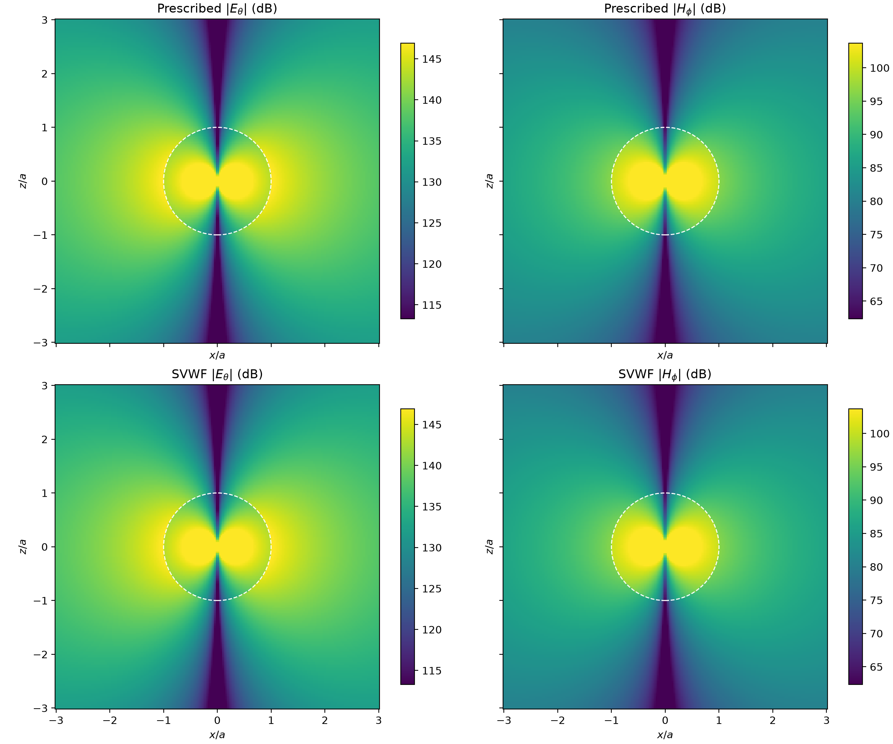
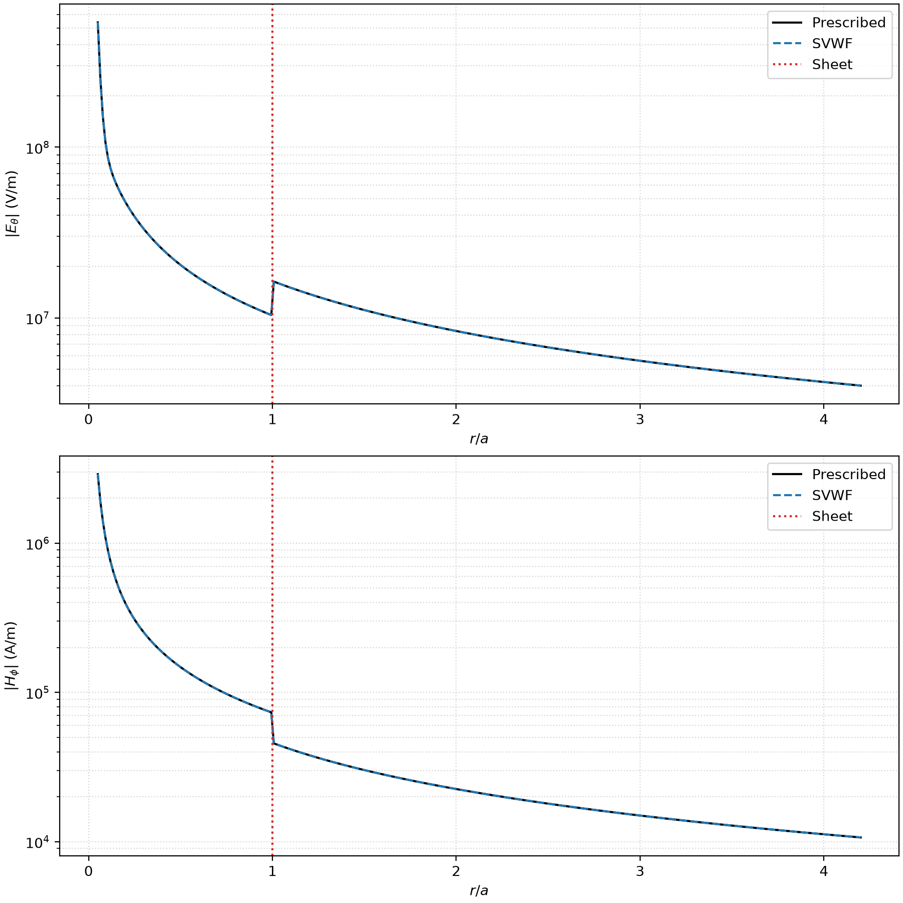
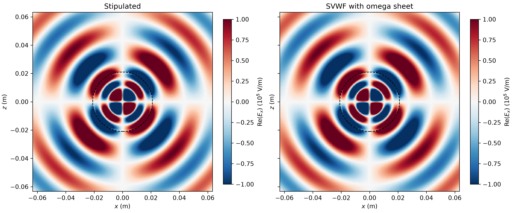
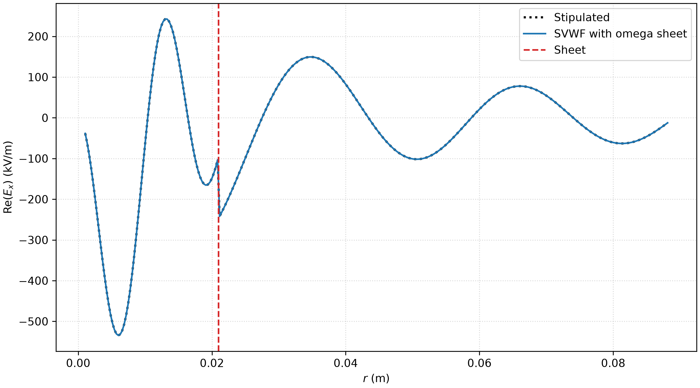

.. _metasurface_applications:

=================================================
Metasurface Applications: Theory-Guided Examples
=================================================

This chapter develops metasurface applications in two stages.  Each example
first establishes the physical model, constitutive specialization, and
parameter-extraction procedure.  Numerical settings, results, and their
interpretation are added only after that theoretical foundation is in place.

The examples use the general GSTC implementation described in
:ref:`gstc_implementation_note`.  The solver is not restricted to any one
material class: it accepts four general tangential constitutive blocks.  An
individual application is obtained by imposing the symmetry, reciprocity, and
material constraints appropriate to that example.

Constitutive notation and solver notation
==========================================

Fields-to-currents constitutive map
-----------------------------------

Let the sheet-current and average-field state vectors be

.. math::

   \mathbf{s}
   :=
   \begin{bmatrix}
      \mathbf{J}_s \\
      \mathbf{M}_s
   \end{bmatrix},
   \qquad
   \mathbf{f}
   :=
   \begin{bmatrix}
      \mathbf{E}_{t,\mathrm{avg}} \\
      \mathbf{H}_{t,\mathrm{avg}}
   \end{bmatrix}.

In the physical notation commonly used for bianisotropic GSTCs
:cite:p:`BudhuGrbic+2021+4075+4112,budhu2026sie`, the constitutive relation is

.. math::
   :label: eq:applications_gstc_physical

   \mathbf{s}
   =
   \underbrace{
   \begin{bmatrix}
      \mathbf{Y}_{ee} & \boldsymbol{\chi}_{em} \\
      \boldsymbol{\gamma}_{me} & \mathbf{Z}_{mm}
   \end{bmatrix}}_{\boldsymbol{\Lambda}}
   \mathbf{f}.

The four blocks have different physical roles and, in general, different
units: :math:`\mathbf{Y}_{ee}` is an electric surface admittance,
:math:`\mathbf{Z}_{mm}` is a magnetic surface impedance, and
:math:`\boldsymbol{\chi}_{em}` and :math:`\boldsymbol{\gamma}_{me}` are the
magnetoelectric coupling tensors.

The C++/CUDA implementation stores the same complete map using the name
:math:`\mathbb{Y}_{\mathrm{solver}}`:

.. math::
   :label: eq:applications_solver_forward_map

   \mathbb{Y}_{\mathrm{solver}}
   \equiv \boldsymbol{\Lambda}
   =
   \begin{bmatrix}
      \mathbf{Y}_{ee} & \mathbf{Y}_{em} \\
      \mathbf{Y}_{me} & \mathbf{Y}_{mm}
   \end{bmatrix}.

In this code-facing representation, :math:`\mathbf{Y}_{em}` is the storage
name for :math:`\boldsymbol{\chi}_{em}`, :math:`\mathbf{Y}_{me}` is the
storage name for :math:`\boldsymbol{\gamma}_{me}`, and
:math:`\mathbf{Y}_{mm}` is the storage name for the physical magnetic
impedance :math:`\mathbf{Z}_{mm}`.  The symbol
:math:`\mathbb{Y}_{\mathrm{solver}}` is therefore a *mixed-unit constitutive
map*, not an ordinary admittance tensor.

.. list-table:: Literature, Python, and C++ notation
   :header-rows: 1
   :widths: 28 25 25 42

   * - Physical quantity
     - Literature symbol
     - Python key
     - C++/CUDA identifier
   * - Electric surface admittance
     - :math:`\mathbf{Y}_{ee}`
     - ``Y``
     - ``Y_ee``
   * - Magnetoelectric coupling
     - :math:`\boldsymbol{\chi}_{em}`
     - ``Chi``
     - ``Y_em``
   * - Electromagnetic coupling
     - :math:`\boldsymbol{\gamma}_{me}`
     - ``Gamma``
     - ``Y_me``
   * - Magnetic surface impedance
     - :math:`\mathbf{Z}_{mm}`
     - ``Z``
     - ``Y_mm``
   * - Complete fields-to-currents map
     - :math:`\boldsymbol{\Lambda}`
     - assembled from the four keys
     - ``Y_tot``

Local component representation
------------------------------

At a point on the surface, let
:math:`(\hat{\mathbf{u}},\hat{\mathbf{v}})` be an oriented orthonormal basis
of the tangent plane.  The general map used by the solver has the component
representation

.. math::
   :label: eq:applications_general_4x4

   \begin{bmatrix}
      J_u \\ J_v \\ M_u \\ M_v
   \end{bmatrix}
   =
   \begin{bmatrix}
      Y_{ee}^{uu} & Y_{ee}^{uv} & Y_{em}^{uu} & Y_{em}^{uv} \\
      Y_{ee}^{vu} & Y_{ee}^{vv} & Y_{em}^{vu} & Y_{em}^{vv} \\
      Y_{me}^{uu} & Y_{me}^{uv} & Y_{mm}^{uu} & Y_{mm}^{uv} \\
      Y_{me}^{vu} & Y_{me}^{vv} & Y_{mm}^{vu} & Y_{mm}^{vv}
   \end{bmatrix}
   \begin{bmatrix}
      E_{u,\mathrm{avg}} \\
      E_{v,\mathrm{avg}} \\
      H_{u,\mathrm{avg}} \\
      H_{v,\mathrm{avg}}
   \end{bmatrix}.

No isotropy or reciprocity has been imposed in
:eq:`eq:applications_general_4x4`.  All four :math:`2\times2` tangential
blocks may be non-diagonal and spatially varying.

Currents-to-fields inverse map
------------------------------

The matrix assembly also uses the reverse relation.  In the solver notation,

.. math::
   :label: eq:applications_solver_inverse_map

   \mathbf{f}
   = \mathbb{Z}_{\mathrm{solver}}\mathbf{s},
   \qquad
   \mathbb{Z}_{\mathrm{solver}}
   := \mathbb{Y}_{\mathrm{solver}}^{-1}
   = \boldsymbol{\Lambda}^{-1}.

The inverse must be taken at the complete :math:`4\times4` level because the
off-diagonal magnetoelectric blocks couple the electric and magnetic
subsystems.  In particular, the individual diagonal blocks cannot generally
be inverted independently.

.. important::

   The complete inverse map :math:`\mathbb{Z}_{\mathrm{solver}}` is not the
   physical magnetic impedance block :math:`\mathbf{Z}_{mm}`.  The typography
   and the ``solver`` subscript distinguish these two objects.  In the source
   code, they correspond to ``Z_tot`` and ``Y_mm``, respectively.

Application 1: reciprocal omega-type biisotropic sheet
======================================================

The first application will reproduce the reflectionless spherical matching
layer of :cite:p:`budhu2026sie`.  This section begins with the constitutive
specialization.  The dipole transformation, scalar-parameter extraction,
numerical reproduction, and result interpretation will be developed in the
following stages.

Double-overbar normal operator
------------------------------

Following the notation used for omega metasurfaces, define the double-overbar
normal operator :math:`\overline{\overline{\mathbf n}}` by its action on any
tangential vector :math:`\mathbf{a}_t`:

.. math::
   :label: eq:applications_n_dyadic_definition

   \overline{\overline{\mathbf n}}\,\mathbf{a}_t
   := \hat{\mathbf n}\times\mathbf{a}_t.

Equivalently,
:math:`\overline{\overline{\mathbf n}}
=\hat{\mathbf n}\times\mathbf{I}_t`, where :math:`\mathbf{I}_t` is the
tangential identity dyadic.  For a right-handed local frame satisfying

.. math::

   \hat{\mathbf n}\times\hat{\mathbf u}=\hat{\mathbf v},
   \qquad
   \hat{\mathbf n}\times\hat{\mathbf v}=-\hat{\mathbf u},

its local matrix is

.. math::
   :label: eq:applications_n_dyadic_matrix

   \left[\overline{\overline{\mathbf n}}\right]_{(u,v)}
   =
   \begin{bmatrix}
      0 & -1 \\
      1 & 0
   \end{bmatrix}.

Thus,

.. math::

   \overline{\overline{\mathbf n}}
   \begin{bmatrix}a_u\\a_v\end{bmatrix}
   =
   \begin{bmatrix}-a_v\\a_u\end{bmatrix}.

This is the dyadic form of the cross product already used by the solver.  It
will be used instead of introducing a separate rotation symbol.

Reciprocal omega specialization
-------------------------------

For a reciprocal, isotropic, omega-type sheet, the four physical constitutive
blocks reduce to

.. math::
   :label: eq:applications_omega_blocks

   \mathbf{Y}_{ee}=Y\mathbf{I}_t,
   \qquad
   \mathbf{Z}_{mm}=Z\mathbf{I}_t,
   \qquad
   \boldsymbol{\chi}_{em}
      =-\chi\overline{\overline{\mathbf n}},
   \qquad
   \boldsymbol{\gamma}_{me}
      =-\boldsymbol{\chi}_{em}^{\mathsf T}.

Since
:math:`\overline{\overline{\mathbf n}}^{\mathsf T}
=-\overline{\overline{\mathbf n}}`, reciprocity gives

.. math::

   \boldsymbol{\gamma}_{me}
   =-\chi\overline{\overline{\mathbf n}}
   =\boldsymbol{\chi}_{em}.

The fields-to-currents map for this material is therefore

.. math::
   :label: eq:applications_omega_forward_map

   \begin{bmatrix}
      \mathbf{J}_s \\
      \mathbf{M}_s
   \end{bmatrix}
   =
   \underbrace{
   \begin{bmatrix}
      Y\mathbf{I}_t
      & -\chi\overline{\overline{\mathbf n}} \\
      -\chi\overline{\overline{\mathbf n}}
      & Z\mathbf{I}_t
   \end{bmatrix}}_{\mathbb{Y}_{\mathrm{solver},\Omega}}
   \begin{bmatrix}
      \mathbf{E}_{t,\mathrm{avg}} \\
      \mathbf{H}_{t,\mathrm{avg}}
   \end{bmatrix}.

Using :eq:`eq:applications_n_dyadic_matrix`, the explicit local
:math:`4\times4` form is

.. math::
   :label: eq:applications_omega_4x4

   \begin{bmatrix}
      J_{s,u} \\ J_{s,v} \\ M_{s,u} \\ M_{s,v}
   \end{bmatrix}
   =
   \begin{bmatrix}
      Y & 0 & 0 & \chi \\
      0 & Y & -\chi & 0 \\
      0 & \chi & Z & 0 \\
      -\chi & 0 & 0 & Z
   \end{bmatrix}
   \begin{bmatrix}
      E_{u,\mathrm{avg}} \\
      E_{v,\mathrm{avg}} \\
      H_{u,\mathrm{avg}} \\
      H_{v,\mathrm{avg}}
   \end{bmatrix}.

Both magnetoelectric blocks have the same local matrix.  Reversing the
orientation of the tangent basis reverses the sign of both blocks together;
it does not reverse only one of them.

Reverse map used in matrix assembly
-----------------------------------

The complete inverse required by the implementation is

.. math::
   :label: eq:applications_omega_inverse_map

   \mathbb{Z}_{\mathrm{solver},\Omega}
   =\mathbb{Y}_{\mathrm{solver},\Omega}^{-1}
   =
   \frac{1}{\chi^2+YZ}
   \begin{bmatrix}
      Z\mathbf{I}_t
      & \chi\overline{\overline{\mathbf n}} \\
      \chi\overline{\overline{\mathbf n}}
      & Y\mathbf{I}_t
   \end{bmatrix}.

The factor :math:`\chi^2+YZ` is the same denominator that appears in the
current-to-field relations of :cite:p:`budhu2026sie`.  The solver obtains this
structure by inverting the full forward map; it does not require a separate
omega-specific assembly algorithm.

Parameter extraction
--------------------

Following :cite:p:`budhu2026sie`, define the electric and magnetic sheet
currents as the sums of the equivalent currents on the two sides of the
surface,

.. math::

   \mathbf{J}_s=\mathbf{J}_1+\mathbf{J}_2,
   \qquad
   \mathbf{M}_s=\mathbf{M}_1+\mathbf{M}_2,

and define the corresponding current differences by

.. math::

   \Delta\mathbf{J}=\mathbf{J}_1-\mathbf{J}_2,
   \qquad
   \Delta\mathbf{M}=\mathbf{M}_1-\mathbf{M}_2.

Love's equivalent-current definitions relate these differences to the
average tangential fields:

.. math::

   \mathbf{E}_{t,\mathrm{avg}}
   =\frac{1}{2}\hat{\mathbf n}\times\Delta\mathbf{M},
   \qquad
   \mathbf{H}_{t,\mathrm{avg}}
   =-\frac{1}{2}\hat{\mathbf n}\times\Delta\mathbf{J}.

Equivalently,

.. math::

   \Delta\mathbf{M}
   =-2\hat{\mathbf n}\times\mathbf{E}_{t,\mathrm{avg}},
   \qquad
   \Delta\mathbf{J}
   =2\hat{\mathbf n}\times\mathbf{H}_{t,\mathrm{avg}}.

Thus, the conjugated current differences that appear in the parameter
extraction of :cite:p:`budhu2026sie` are rotated versions of the conjugated
average tangential fields.  This observation permits a compact derivation
directly from the forward GSTC.  For the reciprocal biisotropic omega sheet,

.. math::

   \mathbf{J}_s
   =Y\mathbf{E}_{t,\mathrm{avg}}
   -\chi\hat{\mathbf n}\times\mathbf{H}_{t,\mathrm{avg}},

.. math::

   \mathbf{M}_s
   =-\chi\hat{\mathbf n}\times\mathbf{E}_{t,\mathrm{avg}}
   +Z\mathbf{H}_{t,\mathrm{avg}}.

Taking the dot product of the electric-current equation with
:math:`\mathbf{E}_{t,\mathrm{avg}}^*` and the magnetic-current equation with
:math:`\mathbf{H}_{t,\mathrm{avg}}^*` gives

.. math::

   \mathbf{J}_s\cdot\mathbf{E}_{t,\mathrm{avg}}^*
   =Y\,\mathbf{E}_{t,\mathrm{avg}}
      \cdot\mathbf{E}_{t,\mathrm{avg}}^*
   -\chi(\hat{\mathbf n}\times\mathbf{H}_{t,\mathrm{avg}})
      \cdot\mathbf{E}_{t,\mathrm{avg}}^*,

.. math::

   \mathbf{M}_s\cdot\mathbf{H}_{t,\mathrm{avg}}^*
   =-\chi(\hat{\mathbf n}\times\mathbf{E}_{t,\mathrm{avg}})
      \cdot\mathbf{H}_{t,\mathrm{avg}}^*
   +Z\,\mathbf{H}_{t,\mathrm{avg}}
      \cdot\mathbf{H}_{t,\mathrm{avg}}^*.

Define the scalar coupling product

.. math::

   q
   :=(\hat{\mathbf n}\times\mathbf{E}_{t,\mathrm{avg}})
      \cdot\mathbf{H}_{t,\mathrm{avg}}^*.

The skew symmetry of the tangential rotation gives

.. math::

   (\hat{\mathbf n}\times\mathbf{H}_{t,\mathrm{avg}})
      \cdot\mathbf{E}_{t,\mathrm{avg}}^*
   =-q^*.

The two projected GSTCs can therefore be written compactly as

.. math::

   \mathbf{J}_s\cdot\mathbf{E}_{t,\mathrm{avg}}^*
   =Y\left\lVert\mathbf{E}_{t,\mathrm{avg}}\right\rVert^2
   +\chi q^*,

.. math::

   \mathbf{M}_s\cdot\mathbf{H}_{t,\mathrm{avg}}^*
   =-\chi q
   +Z\left\lVert\mathbf{H}_{t,\mathrm{avg}}\right\rVert^2.

For a reciprocal, lossless omega sheet, write

.. math::

   Y=jB,
   \qquad
   Z=jX,
   \qquad
   B,X,\chi\in\mathbb{R}.

Taking the real parts of the projected equations yields

.. math::

   \operatorname{Re}\!\left[
      \mathbf{J}_s\cdot\mathbf{E}_{t,\mathrm{avg}}^*
   \right]
   =\chi\operatorname{Re}[q],

.. math::

   \operatorname{Re}\!\left[
      \mathbf{M}_s\cdot\mathbf{H}_{t,\mathrm{avg}}^*
   \right]
   =-\chi\operatorname{Re}[q].

.. admonition:: Compatibility and choice of :math:`\chi`
   :class: important

   Provided that :math:`\operatorname{Re}[q]\neq 0`, the electric- and
   magnetic-current equations independently give

   .. math::

      \chi_J
      =\frac{
         \operatorname{Re}\!\left[
            \mathbf{J}_s\cdot\mathbf{E}_{t,\mathrm{avg}}^*
         \right]
      }{
         \operatorname{Re}[q]
      },
      \qquad
      \chi_M
      =-\frac{
         \operatorname{Re}\!\left[
            \mathbf{M}_s\cdot\mathbf{H}_{t,\mathrm{avg}}^*
         \right]
      }{
         \operatorname{Re}[q]
      }.

   An exact reciprocal, lossless omega-sheet transformation requires one
   common coupling parameter.  Thus, :math:`\chi_J=\chi_M`, or equivalently,

   .. math::

      \operatorname{Re}\!\left[
         \mathbf{J}_s\cdot\mathbf{E}_{t,\mathrm{avg}}^*
         +\mathbf{M}_s\cdot\mathbf{H}_{t,\mathrm{avg}}^*
      \right]
      =0.

   The left-hand side is twice the time-average real power absorbed by the
   sheet.  Consequently, equality of the two values of :math:`\chi` is the
   compatibility condition expressing local normal-power conservation.  It
   need not be introduced separately in the projected derivation; it follows
   necessarily when the prescribed fields admit an exact lossless solution.

   In an exact calculation, either expression for :math:`\chi` may be used.
   For numerical data, a symmetric estimate that treats both projected GSTCs
   equally is

   .. math::

      \chi
      =\frac{\chi_J+\chi_M}{2}
      =\frac{
         \operatorname{Re}\!\left[
            \mathbf{J}_s\cdot\mathbf{E}_{t,\mathrm{avg}}^*
         \right]
         -\operatorname{Re}\!\left[
            \mathbf{M}_s\cdot\mathbf{H}_{t,\mathrm{avg}}^*
         \right]
      }{
         2\operatorname{Re}[q]
      }.

   The discrepancy :math:`|\chi_J-\chi_M|` should still be monitored: a
   nonzero value signals that no single lossless omega sheet reproduces the
   prescribed fields exactly.  If :math:`\operatorname{Re}[q]=0`, neither
   real-part equation determines :math:`\chi`; this is a degenerate case that
   requires information from the unprojected vector GSTCs or an additional
   transformation.

The imaginary parts give the real susceptance and reactance parameters

.. math::

   B
   =\frac{
      \operatorname{Im}\!\left[
         \mathbf{J}_s\cdot\mathbf{E}_{t,\mathrm{avg}}^*
      \right]
      +\chi\operatorname{Im}[q]
   }{
      \left\lVert\mathbf{E}_{t,\mathrm{avg}}\right\rVert^2
   },

.. math::

   X
   =\frac{
      \operatorname{Im}\!\left[
         \mathbf{M}_s\cdot\mathbf{H}_{t,\mathrm{avg}}^*
      \right]
      +\chi\operatorname{Im}[q]
   }{
      \left\lVert\mathbf{H}_{t,\mathrm{avg}}\right\rVert^2
   }.

The projected extraction is implemented by
:func:`sie_mom.gstc.omega_biisotropic.form_boundary_quantities`, which forms
the average tangential fields and equivalent sheet currents from the
prescribed interior and exterior fields.  The application routine
``extract_case_parameters`` then calls
:func:`sie_mom.gstc.omega_biisotropic.extract_lossless_omega_projected` to
evaluate the projected formulas above.  The resulting parameters are checked
by
:func:`sie_mom.gstc.omega_biisotropic.reconstruct_omega_currents`, which
reconstructs the sheet currents and reports the absolute and relative
residuals stored in the extraction result.

.. admonition:: Current-only form and connection with :cite:p:`budhu2026sie`'s extraction
   :class: note

   To translate the projected expressions into the notation used in that
   work, first use the Love-current identities to obtain

   .. math::

      \left\lVert\mathbf{E}_{t,\mathrm{avg}}\right\rVert^2
      =\frac{1}{4}\Delta\mathbf{M}\cdot\Delta\mathbf{M}^*,
      \qquad
      \left\lVert\mathbf{H}_{t,\mathrm{avg}}\right\rVert^2
      =\frac{1}{4}\Delta\mathbf{J}\cdot\Delta\mathbf{J}^*,

   .. math::

      q
      =-\frac{1}{4}
         (\hat{\mathbf n}\times\Delta\mathbf{M})
         \cdot\Delta\mathbf{J}^*,

   and

   .. math::

      \mathbf{J}_s\cdot\mathbf{E}_{t,\mathrm{avg}}^*
      =-\frac{1}{2}
         (\hat{\mathbf n}\times\mathbf{J}_s)
         \cdot\Delta\mathbf{M}^*,
      \qquad
      \mathbf{M}_s\cdot\mathbf{H}_{t,\mathrm{avg}}^*
      =\frac{1}{2}
         (\hat{\mathbf n}\times\mathbf{M}_s)
         \cdot\Delta\mathbf{J}^*.

   Substitution into the expression for :math:`B`, followed by
   :math:`Y=jB`, gives

   .. math::

      Y
      =-j\frac{
         2\operatorname{Im}\!\left[
            (\hat{\mathbf n}\times\mathbf{J}_s)
            \cdot\Delta\mathbf{M}^*
         \right]
      }{
         \Delta\mathbf{M}\cdot\Delta\mathbf{M}^*
      }
      -j\frac{
         \chi\operatorname{Im}\!\left[
            (\hat{\mathbf n}\times\Delta\mathbf{J})
            \cdot\Delta\mathbf{M}^*
         \right]
      }{
         \Delta\mathbf{M}\cdot\Delta\mathbf{M}^*
      }.

   Here the identity

   .. math::

      \operatorname{Im}\!\left[
         (\hat{\mathbf n}\times\Delta\mathbf{M})
         \cdot\Delta\mathbf{J}^*
      \right]
      =
      \operatorname{Im}\!\left[
         (\hat{\mathbf n}\times\Delta\mathbf{J})
         \cdot\Delta\mathbf{M}^*
      \right]

   has been used to match the ordering in the paper.  Similarly, substituting
   into :math:`X` and using :math:`Z=jX` gives

   .. math::

      Z
      =j\frac{
         2\operatorname{Im}\!\left[
            (\hat{\mathbf n}\times\mathbf{M}_s)
            \cdot\Delta\mathbf{J}^*
         \right]
      }{
         \Delta\mathbf{J}\cdot\Delta\mathbf{J}^*
      }
      -j\frac{
         \chi\operatorname{Im}\!\left[
            (\hat{\mathbf n}\times\Delta\mathbf{M})
            \cdot\Delta\mathbf{J}^*
         \right]
      }{
         \Delta\mathbf{J}\cdot\Delta\mathbf{J}^*
      }.

   Finally, substituting the current identities into the symmetric estimate
   :math:`\chi=(\chi_J+\chi_M)/2` and expanding the sums and differences gives

   .. math::

      \chi
      =\frac{
         2\operatorname{Re}\!\left[
            -(\hat{\mathbf n}\times\mathbf{M}_1)\cdot\mathbf{J}_2^*
            +(\hat{\mathbf n}\times\mathbf{M}_2)\cdot\mathbf{J}_1^*
         \right]
      }{
         \operatorname{Re}\!\left[
            (\hat{\mathbf n}\times\Delta\mathbf{M})
            \cdot\Delta\mathbf{J}^*
         \right]
      }.

   These are the three current-only expressions reported by
   :cite:p:`budhu2026sie`.  In particular, the paper's formula for
   :math:`\chi` is the symmetric value obtained from the two projected GSTCs.
   When local normal power is conserved,

   .. math::

      \operatorname{Re}\!\left[
         (\hat{\mathbf n}\times\mathbf{M}_1)\cdot\mathbf{J}_1^*
      \right]
      =
      \operatorname{Re}\!\left[
         (\hat{\mathbf n}\times\mathbf{M}_2)\cdot\mathbf{J}_2^*
      \right],

   this symmetric value satisfies :math:`\chi_J=\chi_M=\chi`; hence the
   resulting :math:`Y`, :math:`Z`, and :math:`\chi` reproduce both projected
   GSTCs exactly.  Without that compatibility condition, the same formula for
   :math:`\chi` is only the equal-weight fit to the two inconsistent real-part
   equations, so a lossless omega sheet with these parameters does not
   reproduce the prescribed transformation exactly.

Least-squares extraction
------------------------

The least-squares route uses the same boundary quantities as the projected
route, but determines :math:`(B, X, \chi)` simultaneously at each surface
point.  Substituting :math:`Y=jB` and :math:`Z=jX` into the two vector GSTCs
and collecting the three real unknowns gives

.. math::
   :label: eq:applications_omega_ls_complex

   \underbrace{
   \begin{bmatrix}
      j\mathbf{E}_{t,\mathrm{avg}} & \mathbf{0}
         & -\hat{\mathbf n}\times\mathbf{H}_{t,\mathrm{avg}} \\
      \mathbf{0} & j\mathbf{H}_{t,\mathrm{avg}}
         & -\hat{\mathbf n}\times\mathbf{E}_{t,\mathrm{avg}}
   \end{bmatrix}}_{\mathbf C}
   \underbrace{
   \begin{bmatrix}
      B \\ X \\ \chi
   \end{bmatrix}}_{\mathbf p}
   =
   \underbrace{
   \begin{bmatrix}
      \mathbf J_s \\
      \mathbf M_s
   \end{bmatrix}}_{\mathbf s},
   \qquad
   \mathbf p\in\mathbb R^3.

Each vector appearing as an entry of :math:`\mathbf C` is a two-component
tangential column.  Thus, at one surface point,
:math:`\mathbf C\in\mathbb C^{4\times3}` and
:math:`\mathbf s\in\mathbb C^4`.  The restriction
:math:`\mathbf p\in\mathbb R^3` imposes losslessness directly rather than
extracting unrestricted complex parameters and discarding their inadmissible
parts afterward.

For prescribed fields that do not satisfy all four complex component
equations exactly, define the real-constrained least-squares estimate by

.. math::
   :label: eq:applications_omega_ls_objective

   \mathbf p_{\mathrm{LS}}
   =\underset{\mathbf p\in\mathbb R^3}{\operatorname{argmin}}
      \left\lVert\mathbf C\mathbf p-\mathbf s\right\rVert_2^2.

To obtain an ordinary real system, write
:math:`\mathbf C=\mathbf C_R+j\mathbf C_I` and
:math:`\mathbf s=\mathbf s_R+j\mathbf s_I`.  Since :math:`\mathbf p` is real,

.. math::

   \mathbf C\mathbf p-\mathbf s
   =\left(\mathbf C_R\mathbf p-\mathbf s_R\right)
   +j\left(\mathbf C_I\mathbf p-\mathbf s_I\right),

and therefore

.. math::

   \left\lVert\mathbf C\mathbf p-\mathbf s\right\rVert_2^2
   =\left\lVert\mathbf C_R\mathbf p-\mathbf s_R\right\rVert_2^2
   +\left\lVert\mathbf C_I\mathbf p-\mathbf s_I\right\rVert_2^2.

Consequently, :eq:`eq:applications_omega_ls_objective` is exactly equivalent
to the real least-squares problem

.. math::
   :label: eq:applications_omega_ls_real

   \mathbf p_{\mathrm{LS}}
   =\underset{\mathbf p\in\mathbb R^3}{\operatorname{argmin}}
   \left\lVert
   \underbrace{
   \begin{bmatrix}
      \operatorname{Re}\mathbf C \\
      \operatorname{Im}\mathbf C
   \end{bmatrix}}_{\mathbf A}
   \mathbf p
   -
   \underbrace{
   \begin{bmatrix}
      \operatorname{Re}\mathbf s \\
      \operatorname{Im}\mathbf s
   \end{bmatrix}}_{\mathbf b}
   \right\rVert_2^2,
   \qquad
   \mathbf A\in\mathbb R^{8\times3},
   \quad
   \mathbf b\in\mathbb R^8.

Differentiating the real quadratic objective with respect to
:math:`\mathbf p` gives the stationarity condition

.. math::
   :label: eq:applications_omega_ls_normal

   \mathbf A^{\mathsf T}\mathbf A\,\mathbf p
   =\mathbf A^{\mathsf T}\mathbf b.

The identities

.. math::

   \mathbf A^{\mathsf T}\mathbf A
   =\operatorname{Re}(\mathbf C^{\mathsf H}\mathbf C),
   \qquad
   \mathbf A^{\mathsf T}\mathbf b
   =\operatorname{Re}(\mathbf C^{\mathsf H}\mathbf s)

show that :eq:`eq:applications_omega_ls_normal` is equivalently

.. math::

   \operatorname{Re}(\mathbf C^{\mathsf H}\mathbf C)\,\mathbf p
   =\operatorname{Re}(\mathbf C^{\mathsf H}\mathbf s).

This last equation characterizes the least-squares minimizer, but it is not
formed explicitly in the numerical implementation because doing so squares
the condition number.  Instead, if
:math:`\mathbf A=\mathbf U\boldsymbol{\Sigma}\mathbf V^{\mathsf T}` is a
singular-value decomposition, then a full-column-rank system has the unique
solution

.. math::

   \mathbf p_{\mathrm{LS}}
   =\mathbf V\boldsymbol{\Sigma}^{-1}\mathbf U^{\mathsf T}\mathbf b
   =\mathbf A^{+}\mathbf b.

If :math:`\operatorname{rank}(\mathbf A)<3`, the prescribed fields do not
determine all three parameters uniquely at that point.  If
:math:`\operatorname{rank}(\mathbf A)=3` but the minimum residual is nonzero,
the fields do not admit an exact reciprocal lossless omega sheet and
:math:`\mathbf p_{\mathrm{LS}}` is an approximation under the selected
residual weighting.

For an exact compatible transformation with
:math:`\operatorname{rank}(\mathbf A)=3`, the least-squares and projected
routes recover the same unique :math:`B`, :math:`X`, and :math:`\chi`.  For
incompatible data they generally differ: the projected route operates on the
two scalar projections, whereas :eq:`eq:applications_omega_ls_real` minimizes
all real and imaginary component residuals simultaneously.

.. admonition:: Impedance scaling of electric and magnetic GSTC residuals
   :class: important

   The electric surface-current residual has units of A/m, whereas the
   magnetic surface-current residual has units of V/m.  Therefore, when the
   residual cannot be made zero, their unweighted concatenated norm depends on
   the chosen unit convention and relative numerical scales.  A physically
   meaningful future application involving incompatible, noisy, or measured
   data should introduce an explicit row weighting, for example by scaling one
   current block with a stated reference impedance, and should report that
   choice.  Column normalization improves numerical conditioning but does not
   replace this physical row weighting.  This distinction is immaterial for
   the exact compatible example developed here, for which the residual is zero
   to numerical precision.

The implementation is provided by
:func:`sie_mom.gstc.omega_biisotropic.extract_lossless_omega_least_squares`.
It constructs :math:`\mathbf C`, stacks its real and imaginary parts to form
:math:`\mathbf A`, and normalizes each column of :math:`\mathbf A` before
calling the SVD-based least-squares solver.  The parameters are unscaled after
the solve.  The returned ``LeastSquaresExtraction`` object records the rank,
singular values, condition number, validity flag, and absolute and relative
current residuals.  The reported singular values and condition number belong
to the column-normalized matrix.  As with the projected route, the residuals
are computed by
:func:`sie_mom.gstc.omega_biisotropic.reconstruct_omega_currents`.

SVWF collocation validation
---------------------------

The first numerical validation uses the spherical-vector-wave-function (SVWF)
solver rather than the SIE solver.  The application extracts the reciprocal
omega parameters from the prescribed boundary fields, forms the four local
:math:`2\times2` GSTC blocks with
:func:`sie_mom.gstc.omega_biisotropic.omega_tensor_blocks`, and passes those
blocks to :func:`spherical_expansion.solver.solve_collocation_general`.  That
solver expands the interior and exterior fields in SVWFs and enforces the
GSTCs at angular collocation points.  A later stage will solve the same
physical transformation with the surface-integral-equation formulation and
compare it with this SVWF reference.

.. note:: Phasor convention in the SVWF validation

   The analytical dipole fields, the omega-parameter extraction routines, and
   all fields saved by this application use the :math:`\exp(+j\omega t)`
   convention.  In this convention an outgoing spherical wave has the spatial
   dependence :math:`\exp(-jkr)`.  The present SVWF implementation instead
   uses :math:`\exp(-j\omega t)`: its outgoing basis contains the spherical
   Hankel function :math:`h_n^{(1)}(kr)\sim\exp(+jkr)/(kr)`, and its magnetic
   field is formed with the factor :math:`1/(j\eta)`.

   The application handles this difference explicitly in
   :func:`~applications.omega_biisotropic_sphere.svwf_dipole_impedance_matching.prescribed_dipole_fields`.
   When called with
   ``svwf_convention=True``, that routine applies ``numpy.conjugate`` to all
   four prescribed phasors: the interior and exterior electric and magnetic
   fields.
   :func:`~applications.omega_biisotropic_sphere.svwf_dipole_impedance_matching.run_svwf_validation`
   uses this option through
   :func:`~applications.omega_biisotropic_sphere.svwf_dipole_impedance_matching.extract_case_parameters`
   when constructing the GSTC tensor blocks and again in its ``incident_field``
   callback supplied to the SVWF solver.
   Equivalently,

   .. math::

      Y_{-}=Y_{+}^{*},\qquad
      Z_{-}=Z_{+}^{*},\qquad
      \chi_{-}=\chi_{+}^{*},

   where the subscripts identify the negative- and positive-time conventions.
   For the reciprocal lossless omega sheet considered here, this gives
   :math:`B_{-}=-B_{+}`, :math:`X_{-}=-X_{+}`, and
   :math:`\chi_{-}=\chi_{+}`.  On the output side,
   :func:`~applications.omega_biisotropic_sphere.svwf_dipole_impedance_matching._evaluate_svwf_total_fields`
   applies ``numpy.conjugate`` to the computed interior total fields and
   exterior transmitted fields, thereby returning them to
   :math:`\exp(+j\omega t)` before the sampled-field comparisons, CSV export,
   and plotting.  Consequently, the agreement with the prescribed analytical
   fields also checks that this convention conversion has been applied
   consistently.

   The CUDA SIE implementation uses the same :math:`\exp(+j\omega t)` convention
   as the analytical dipole fields and the reported application parameters, as
   indicated by its :math:`\exp(-jkr)/(4\pi r)` Green function and
   :math:`+j\omega` operator factors.  The future SIE driver must therefore
   construct its constitutive tensors from the physical values returned by
   ``extract_case_parameters(..., svwf_convention=False)``, or from an
   equivalent exported representation.  It must not use the conjugated values
   generated for the SVWF solver, and it must not apply an additional
   conjugation before assembling the CUDA tensor maps.  Here, ``directly``
   refers to the phasor convention: the scalar parameters still have to be
   assembled into the complete :math:`4\times4` fields-to-currents map and its
   full inverse required by the CUDA mass-matrix assembly.

.. admonition:: Local normal-power matching of the prescribed dipole fields
   :class: important

   The lossless extraction does not itself modify the prescribed fields to
   conserve power.  Before extracting the sheet parameters, the application
   chooses the exterior dipole amplitude so that the outward time-average real
   power density agrees pointwise on the two sides of the sphere.  For
   time-harmonic phasors,

   .. math::

      \left\langle\mathbf S\right\rangle
      =\frac{1}{2}\operatorname{Re}
      \left(\mathbf E\times\mathbf H^*\right),

   and its normal component in an oriented tangential basis
   :math:`(\hat{\mathbf u},\hat{\mathbf v})` is

   .. math::

      P_n
      =\hat{\mathbf n}\cdot\left\langle\mathbf S\right\rangle
      =\frac{1}{2}\operatorname{Re}\!\left(
         E_uH_v^*-E_vH_u^*
      \right).

   On the sphere this becomes

   .. math::

      P_r
      =\frac{1}{2}\operatorname{Re}\!\left(
         E_\theta H_\phi^*-E_\phi H_\theta^*
      \right).

   For the centered, :math:`z`-directed electric dipole,
   :math:`E_\phi=H_\theta=0`, and the exact dipole fields implemented by
   :func:`sie_mom.excitation.evaluate_dipole_fields` give

   .. math::
      :label: eq:applications_dipole_radial_power

      P_r(r,\theta)
      =\frac{k^4\left|p_{\mathrm{eff}}\right|^2}
      {2\eta r^2}\sin^2\theta.

   Therefore, local power conservation at :math:`r=a` requires

   .. math::

      \frac{k_{\mathrm{int}}^4
      \left|p_{\mathrm{eff,int}}\right|^2}{\eta_{\mathrm{int}}}
      =
      \frac{k_{\mathrm{ext}}^4
      \left|p_{\mathrm{eff,ext}}\right|^2}{\eta_{\mathrm{ext}}}.

   The application selects the same phase on both sides and uses

   .. math::
      :label: eq:applications_dipole_power_matched_moment

      \boxed{
      \frac{p_{\mathrm{eff,ext}}}{p_{\mathrm{eff,int}}}
      =
      \left(\frac{k_{\mathrm{int}}}{k_{\mathrm{ext}}}\right)^2
      \sqrt{\frac{\eta_{\mathrm{ext}}}{\eta_{\mathrm{int}}}}
      }.

   For :math:`\epsilon_{r,\mathrm{int}}=7`,
   :math:`\mu_{r,\mathrm{int}}=1`, and free space outside, the ratio is
   :math:`7^{5/4}\simeq 11.386`.  Equal normal power does **not** imply equal
   tangential electric and magnetic fields; the omega sheet supports the
   required field discontinuities while absorbing zero time-average real
   power.

   In the application, ``DipoleMatchingCase.effective_moment_ratio`` evaluates
   :eq:`eq:applications_dipole_power_matched_moment`, and
   ``prescribed_dipole_fields`` constructs the two dipole fields.
   :func:`sie_mom.gstc.omega_biisotropic.normal_power_density` evaluates
   :math:`P_n`, while ``run_svwf_validation`` compares the interior and
   exterior values and reports their relative discrepancy as
   ``prescribed_power_error``.  If the prescribed fields are not locally
   power-compatible, an exact lossless solution generally does not exist and
   the constrained least-squares extraction retains a nonzero residual.

The reproducible reference run uses the configuration file
``applications/omega_biisotropic_sphere/configurations/``
``budhu_10ghz_eps7.json``.  From the repository root, generate the projected
extraction and the extended field-sampling domain with

.. code-block:: console

   .venv/bin/python \
     applications/omega_biisotropic_sphere/svwf_dipole_impedance_matching.py \
     --config applications/omega_biisotropic_sphere/configurations/budhu_10ghz_eps7.json \
     --run-dir applications/omega_biisotropic_sphere/results/budhu_10ghz_eps7/svwf/projected_nmax8 \
     --extraction-method projected \
     --n-max 8 \
     --n-theta 34 \
     --n-phi 33 \
     --zx-span-radii 3.0 \
     --radial-max-radii 4.2

The run writes its resolved input, metrics, and sampled fields beneath the
selected run directory.  Render the figures from those saved data with

.. code-block:: console

   .venv/bin/python \
     applications/omega_biisotropic_sphere/plot_dipole_impedance_matching.py \
     --run-dir applications/omega_biisotropic_sphere/results/budhu_10ghz_eps7/svwf/projected_nmax8

For the :math:`\exp(+j\omega t)` convention, the extracted lossless parameters
are

.. list-table:: Extracted reciprocal omega parameters
   :header-rows: 1
   :widths: 30 35 35

   * - Parameter
     - Value
     - Constitutive quantity
   * - :math:`B`
     - :math:`-3.670564\times10^{-3}\ \mathrm{S}`
     - :math:`Y=jB=-j\,3.670564\times10^{-3}\ \mathrm{S}`
   * - :math:`X`
     - :math:`-1.839119\times10^{2}\ \Omega`
     - :math:`Z=jX=-j\,1.839119\times10^{2}\ \Omega`
   * - :math:`\chi`
     - :math:`3.812329\times10^{-1}`
     - Real, dimensionless omega coupling

These values are constant over the sphere to numerical precision.  The
principal validation metrics for :math:`n_{\max}=8`,
:math:`N_\theta=34`, and :math:`N_\phi=33` are

.. list-table:: SVWF collocation validation metrics
   :header-rows: 1
   :widths: 65 35

   * - Relative metric
     - Value
   * - Prescribed local-power error
     - :math:`2.75\times10^{-16}`
   * - Parameter-uniformity error
     - :math:`3.09\times10^{-15}`
   * - Weighted collocation-system residual
     - :math:`4.57\times10^{-11}`
   * - Interior-reflection error
     - :math:`1.84\times10^{-11}`
   * - Exterior-transmission error
     - :math:`5.07\times10^{-11}`

The native spherical-component comparison is shown first.  For the centered,
:math:`z`-directed electric dipole, the nonzero tangential components are the
polar electric field :math:`E_\theta` and the azimuthal magnetic field
:math:`H_\phi`.  The
:ref:`tangential ZX-plane maps <fig:applications_omega_svwf_tangential_zx>`
show their magnitudes on a decibel scale, with the prescribed fields in the
upper row and the SVWF reconstruction in the lower row.

.. _fig:applications_omega_svwf_tangential_zx:

   Prescribed and SVWF-collocation magnitudes of the tangential
   :math:`E_\theta` and :math:`H_\phi` fields in the normalized ZX plane.  The
   dashed circle marks the omega sheet at :math:`r/a=1`.

The corresponding
:ref:`tangential radial cuts <fig:applications_omega_svwf_tangential_radial>`
are evaluated at :math:`\theta=45^\circ` and :math:`\phi=0^\circ`.  Both
components are discontinuous at the sheet even though their normal real-power
flux is continuous.  The prescribed and SVWF curves overlap throughout both
media.

.. _fig:applications_omega_svwf_tangential_radial:

   Radial cuts of :math:`|E_\theta|` and :math:`|H_\phi|` through the
   prescribed and SVWF-collocation fields.  The vertical dotted line marks the
   omega sheet.

The plotting routine converts the arbitrary effective-moment normalization
used by the field evaluator to the :math:`I\Delta z=1\ \mathrm{A\,m}` interior
current moment used by :cite:p:`budhu2026sie`.  The two panels in the
:ref:`ZX-plane comparison <fig:applications_omega_svwf_ex_zx>` compare the
stipulated :math:`\operatorname{Re}(E_x)` field with the field reconstructed
from the SVWF coefficients.  The dashed circle marks the sheet at
:math:`a=0.7\lambda_0`.

.. admonition:: Dipole Moment Normalization: COMSOL (FEM) vs. SIE / SVWF (MoM)
   :class: note

   The fields compared in Fig. :ref:`fig:applications_omega_svwf_ex_radial`
   and the publication figures are expressed for a physical electric current
   dipole moment of :math:`I\Delta z = 1\ \mathrm{A\,m}`, matching Fig. 3 of
   :cite:p:`budhu2026sie`.

   * **SIE, PMCHWT, and SVWF**: The integral equation and spherical-wave
     solvers evaluate fields using the dimensionless effective moment
     :math:`p_{\mathrm{eff}} = 1.0` (which factors out :math:`\frac{1}{4\pi\varepsilon}`
     for numerical conditioning, as defined in :func:`sie_mom.excitation.evaluate_dipole_fields`).
     To convert these code-unit fields to physical units for :math:`I\Delta z = 1\ \mathrm{A\,m}`,
     they are multiplied by the exact first-principles factor:

     .. math::

        \text{scale} = \frac{-j\eta_{\mathrm{int}}}{4\pi k_{\mathrm{int}} \cdot p_{\mathrm{eff}}}.

   * **COMSOL Multiphysics**: COMSOL's RF Module directly accepts the physical
     current dipole moment :math:`I\Delta z` through the ``ElectricPointDipole``
     feature parameter ``normpI = 1.0[A*m]``. Its output fields are therefore
     already in physical SI units (:math:`\mathrm{V/m}`).

   This factor is not a fitted or empirical parameter; it is the exact
   charge-conservation and permittivity scaling connecting the two source
   definitions.

.. _fig:applications_omega_svwf_ex_zx:

   Stipulated and SVWF-collocation values of
   :math:`\operatorname{Re}(E_x)` in the ZX plane for the reciprocal
   omega matching layer.

The :ref:`radial comparison <fig:applications_omega_svwf_ex_radial>`
uses :math:`\theta=45^\circ` and :math:`\phi=0^\circ`.  The discontinuity at
the sheet is expected: :math:`E_x` contains both normal and tangential
components on this cut, and the impedance-matching transformation prescribes
different fields in the two media while conserving their local normal real
power.

.. _fig:applications_omega_svwf_ex_radial:

   Radial cut of :math:`\operatorname{Re}(E_x)` through the stipulated and
   SVWF-collocation fields.  The vertical dashed line marks the omega sheet.

The stipulated and reconstructed curves overlap at the displayed resolution,
consistent with the residuals above.  The constrained real least-squares
extraction returns the same three parameters to numerical precision for this
exact, power-compatible transformation.  No additional surface-wave pattern
appears when the spherical expansion is increased to :math:`n_{\max}=8`; the
future SIE calculation will provide an independent discretization-based test
of the same GSTC model.
